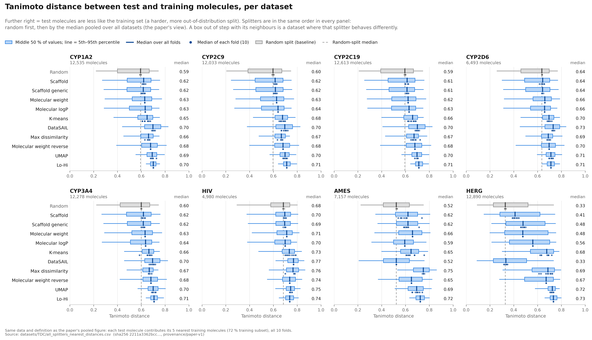
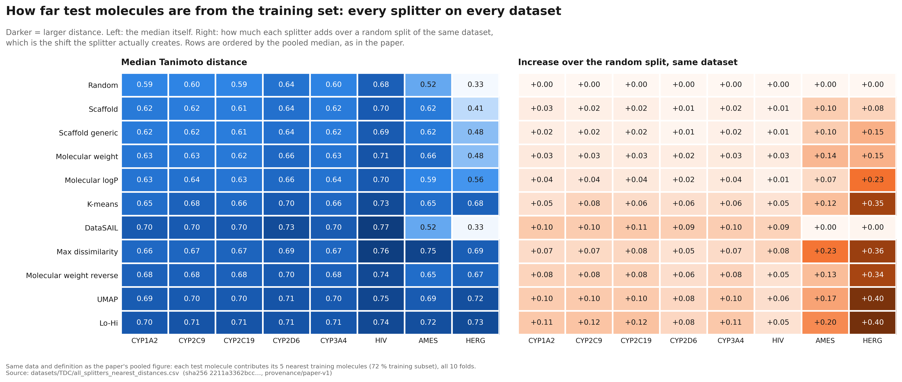

# Exploratory figures

Figures made to understand the results better. **They are not part of the paper.**
Paper figures live in `assets/figures/` (frozen, see `provenance/README.md`); nothing here
is produced by, or overwritten by, the paper notebooks.

Conventions

- One numbered folder per figure, made by one script in `scripts/exploratory/` with the same number.
- Every script reads the frozen published data and writes only into its own folder here.
- Each folder holds PNG (300 dpi) and PDF versions plus a CSV of the plotted numbers.
- Shared names, order and colours come from `scripts/exploratory/_style.py`.
- Add an entry below for each new figure: what it shows, what was learned, how to regenerate.

---

## 01 · Train-test distance per dataset

```bash
python scripts/exploratory/fig01_train_test_distance_per_dataset.py
```

**Question.** The paper shows the distance between test and training molecules for each
splitter with all eight datasets pooled (`assets/figures/distance_distribution`). Does a
splitter create the same shift on every dataset?

**Data and definition.** Unchanged from the paper: `datasets/TDC/all_splitters_nearest_distances.csv`.
For each out-of-distribution test molecule, the distance to each of its 5 nearest molecules
in the training set (the 72 % training subset), over all 10 folds. Only the pooling across
datasets is removed. Boxes show the middle 50 % of values with a 5th–95th percentile line;
dots are the per-fold medians.

| File | Shows |
|---|---|
| [`tanimoto.png`](01_train_test_distance_per_dataset/tanimoto.png) | Tanimoto distance, one panel per dataset, shared axis |
| [`tmd.png`](01_train_test_distance_per_dataset/tmd.png) | Tree Mover's Distance, one panel per dataset, axis differs per panel |
| [`summary.png`](01_train_test_distance_per_dataset/summary.png) | Median Tanimoto distance for every dataset x splitter, and the increase over random |
| [`summary_stats.csv`](01_train_test_distance_per_dataset/summary_stats.csv) | Quantiles, fold-median range and counts behind all three |





**What it shows**

- **The baseline differs a lot between datasets.** A random split already gives a median
  Tanimoto distance of 0.68 on HIV but only 0.33 on HERG (0.52 on AMES, 0.59–0.64 on the
  five CYP sets). The same absolute distance therefore means different things per dataset.
- **The five CYP datasets behave almost identically.** Every splitter adds between +0.01
  and +0.12 over random, in nearly the same order. The pooled paper figure is dominated by
  this group (five of eight datasets).
- **HERG is where splitters matter most.** UMAP and Lo-Hi add +0.40 over random, K-means,
  max dissimilarity and molecular weight reverse about +0.35. Scaffold adds only +0.08.
- **HIV has little room.** Random is already at 0.68, so the strongest splitter (DataSAIL)
  adds +0.09.
- **DataSAIL on AMES and HERG is indistinguishable from random** (+0.00, same spread),
  while on the CYP sets and HIV it is among the most distant splits. This is the largest
  reversal hidden by pooling and is worth understanding before relying on those two cells.
  Related: the published DataSAIL splits for AMES and HIV contain one split repeated ten
  times (all ten test files are identical).
- **Some splitters have no fold-to-fold variation by construction** (molecular weight,
  molecular weight reverse, molecular logP, Lo-Hi: all ten fold medians coincide), while
  K-means and scaffold on AMES vary most between folds (fold medians span 0.15–0.20).
- **TMD ranks splitters differently from Tanimoto.** Molecular weight is by far the largest
  TMD shift on every dataset (TMD grows with molecule size), while molecular weight reverse
  adds little on most datasets (HERG is the exception).

**Caveats**

- Values are the 5 nearest neighbours pooled, not the single nearest neighbour, to match the paper.
- 11 of the 880 dataset x splitter x fold groups (CYP2C19 / CYP2C9, K-means / scaffold) are
  1–6 test molecules short, because those SMILES were not found in the standardized file.
- Test sets are not the same size for every splitter (DataSAIL was run with 14 %, others ~20 %).
